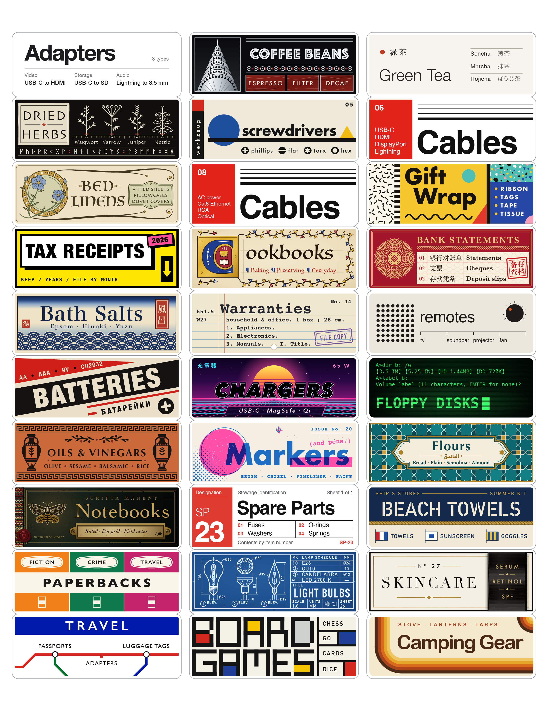

# averylabels

Home and office organisation labels for Avery 30-up address-label sheets (US Letter, 2.625 x 1 in labels). Thirty labels, each in a different design style.



## Files

- `label-styles-print.pdf` / `.ai`: print-ready sheet. Print at 100% (no scaling).
- `label-styles-r3c.ai`: same sheet with die-line outlines, for editing.
- `styles/`: one SVG per label (189 x 72 pt).
- `assemble_styles.py`: lays the SVGs in `styles/` out on the sheet.
- `round2/`: earlier versions.

## Rebuild

```
python3 assemble_styles.py
```

Writes `label-styles.svg`. Fonts are macOS system fonts.
